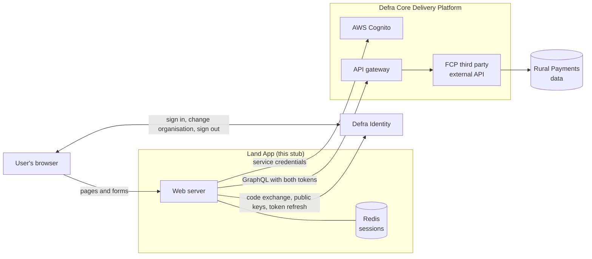
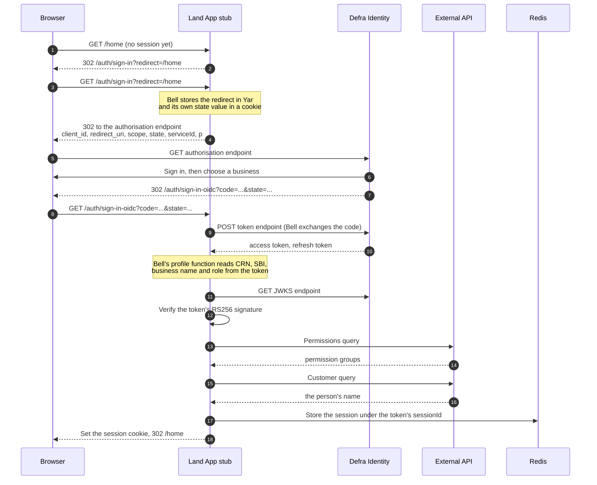
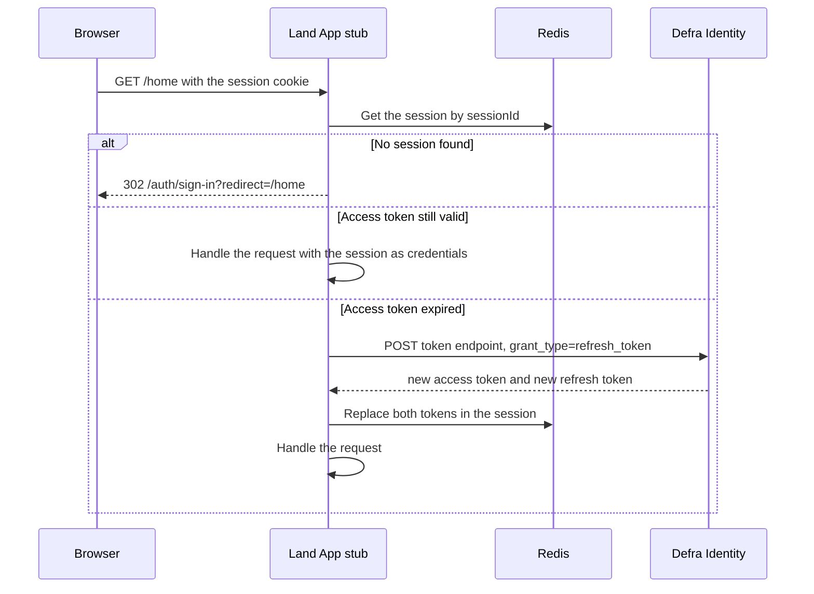
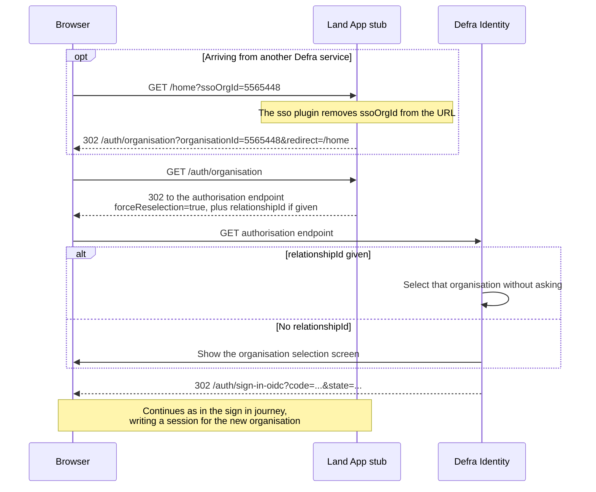
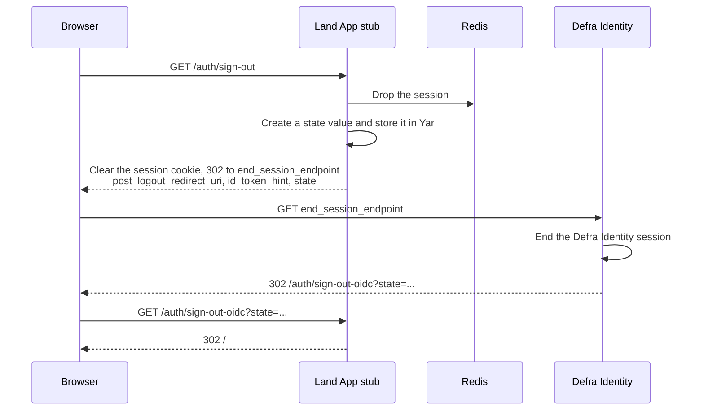
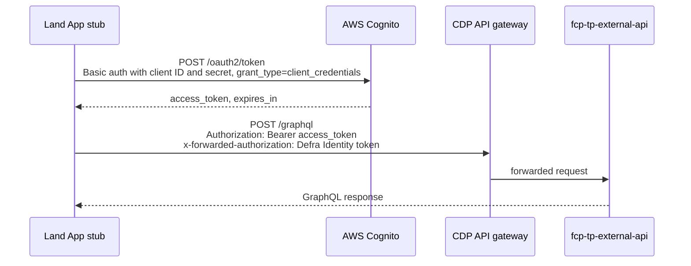
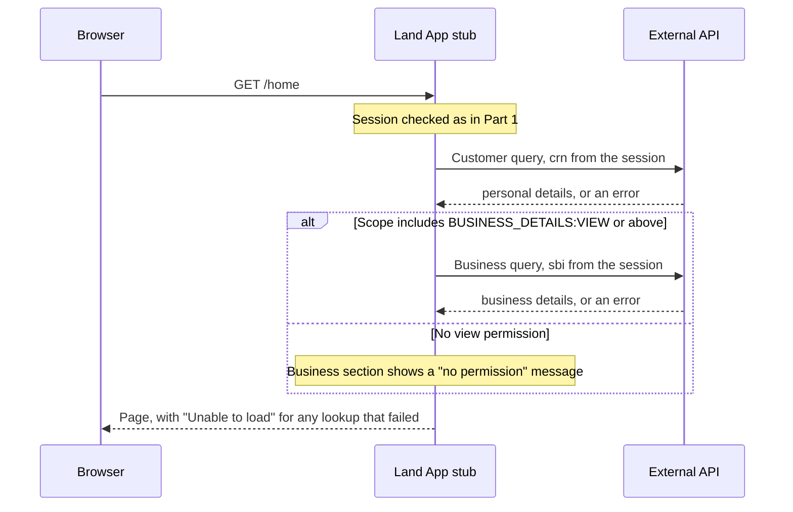
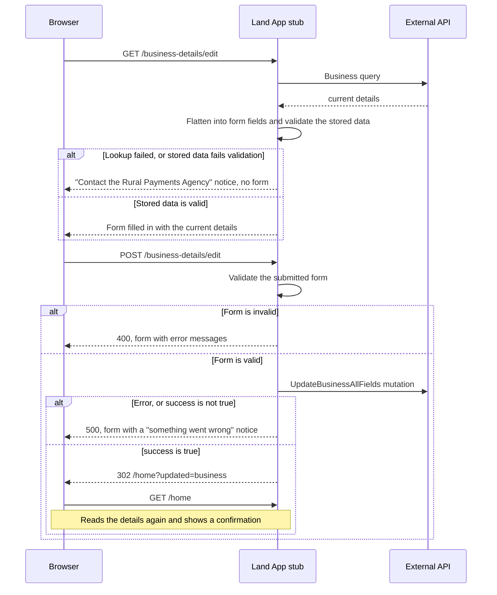

# fcp-land-app-stub

A stub of [The Land App](https://thelandapp.com/) that shows how a third party service
integrates with **Defra Identity** and the **FCP third party external API**.

The Land App is a commercial land management and mapping service used by farmers and
land agents. This repository is not the Land App: it is a deliberately small, readable
stand-in that the Land App team (and any other third party) can use as a working
reference. It shows how to:

1. **Sign a user in** with Defra Identity and keep them signed in.
2. **Work out what they're allowed to do** for the business they've chosen to act for.
3. **Read** their personal details and their business's details.
4. **Update** those details.

Every journey runs locally against stand-ins, so you can try it all without any Defra
credentials. See [Running it locally](#running-it-locally).

It is the third party sibling of [fcp-defra-id-example](https://github.com/DEFRA/fcp-defra-id-example),
which shows the same sign in patterns for an internal Defra service. Because this stub
represents a third party, it uses [Bulma](https://bulma.io/) rather than the GOV.UK
Design System.

> The code comments, especially in `src/auth/`, `src/plugins/auth.js`, `src/routes/` and
> `src/api/`, are part of the documentation. Read them alongside this README.

## Contents

- [How it fits together](#how-it-fits-together)
- [Key terms](#key-terms)
- [If you don't use Hapi](#if-you-dont-use-hapi)
- [What the stub does](#what-the-stub-does)
- [Part 1: Signing in with Defra Identity](#part-1-signing-in-with-defra-identity)
  - [The sign in journey](#the-sign-in-journey)
  - [Two authentication strategies](#two-authentication-strategies)
  - [OpenID Connect discovery](#openid-connect-discovery)
  - [Verifying the token](#verifying-the-token)
  - [What the token tells you](#what-the-token-tells-you)
  - [Every request after sign in](#every-request-after-sign-in)
  - [Changing organisation and single sign on](#changing-organisation-and-single-sign-on)
  - [Signing out](#signing-out)
  - [Security notes](#security-notes)
- [Part 2: Permissions](#part-2-permissions)
  - [Where permissions come from](#where-permissions-come-from)
  - [Permission levels](#permission-levels)
  - [Checking permissions](#checking-permissions)
- [Part 3: Reading and writing data](#part-3-reading-and-writing-data)
  - [The GraphQL client](#the-graphql-client)
  - [The two tokens](#the-two-tokens)
  - [Machine-to-machine authentication with Cognito](#machine-to-machine-authentication-with-cognito)
  - [CDP API gateway URLs](#cdp-api-gateway-urls)
  - [Reading data](#reading-data)
  - [Writing data](#writing-data)
  - [Validating input](#validating-input)
  - [Adding a new query or mutation](#adding-a-new-query-or-mutation)
- [Before you copy this](#before-you-copy-this)
- [Part 4: Running and configuring](#part-4-running-and-configuring)
  - [Running it locally](#running-it-locally)
  - [Running against the API locally](#running-against-the-api-locally)
  - [Integration checklist](#integration-checklist)
  - [Configuration](#configuration)
- [For maintainers](#for-maintainers)
  - [Project structure](#project-structure)
  - [Testing](#testing)
  - [Debugging](#debugging)
  - [Deployment](#deployment)
  - [SonarQube Cloud](#sonarqube-cloud)
- [Licence](#licence)

## How it fits together



The Land App talks to two Defra systems:

- **Defra Identity** signs the user in. The browser is redirected there and back, and the
  Land App's server talks to it directly to exchange codes for tokens.
- The **FCP third party external API** is how the Land App reads and updates Rural
  Payments data. It sits behind an API gateway on Defra's hosting platform. In deployed
  environments the gateway expects an AWS Cognito token that identifies the Land App
  itself.

To integrate for real you need three sets of values from Defra:

| You need | From | Used for |
|---|---|---|
| A Defra Identity client: client ID, client secret, service ID, policy, redirect URIs | Defra Identity onboarding | Signing users in |
| The external API URL | Defra | Reading permissions and data |
| A Cognito client ID, client secret and domain | The CDP platform team | Authenticating the Land App to the API gateway (deployed environments only) |

Locally, [fcp-defra-id-stub](https://github.com/DEFRA/fcp-defra-id-stub) stands in for
Defra Identity, a local checkout of
[fcp-tp-external-api](https://github.com/DEFRA/fcp-tp-external-api) stands in for the
API, and Cognito is switched off.

## Key terms

- **CRN** (customer reference number) identifies the signed in person.
- **SBI** (single business identifier) identifies a farming or land management
  business registered with the Rural Payments Agency. A person can be linked to more
  than one business, and switches between them by "changing organisation".
- **Organisation ID** is Defra Identity's own identifier for a business. It is not the
  SBI. The token carries the selected one as `currentRelationshipId`, and it is what you
  pass when changing organisation.
- **Rural Payments** is the Defra service that holds those businesses and the
  permissions a person has on each one. Defra Identity proves who the person is; Rural
  Payments data says which businesses they can act for and what they're allowed to do.
- **Permission group and level**: a permission is a pair such as `BUSINESS_DETAILS` at
  level `VIEW`. See [Part 2: Permissions](#part-2-permissions).
- **OpenID Connect (OIDC)** is the standard sign in protocol, built on OAuth 2.0, that
  Defra Identity speaks.
- **JWT** (JSON Web Token) is a signed, base64-encoded JSON document. Defra Identity's
  tokens are JWTs, so anyone can read the claims inside, but only Defra Identity can sign
  them.
- **JWKS** (JSON Web Key Set) is the list of public keys you use to check a JWT's
  signature.
- **Access token and refresh token**: the access token proves the user is signed in and
  expires quickly. The refresh token is exchanged for a new pair without asking the user
  to sign in again.
- **GraphQL** is the query language the external API uses. Every request is a `POST` to
  one URL. A **query** reads data and a **mutation** changes it, and the request names
  exactly which fields it wants back.
- **CDP** (Core Delivery Platform) is the shared hosting platform Defra services,
  including the external API, run on.
- **Cognito** is the AWS service that issues tokens identifying a calling *service* (not
  a user) to the CDP API gateway.

## If you don't use Hapi

The patterns here don't depend on the stub's tech stack. If you use something else, this
is what each piece does:

| Job | In this stub | Equivalent elsewhere |
|---|---|---|
| Web framework | [Hapi](https://hapi.dev/) | Express, Fastify, Django, Rails |
| OAuth 2.0 / OIDC client | `@hapi/bell` | Any OIDC client library, such as `openid-client` or Passport |
| Session authentication on each request | `@hapi/cookie` | Session middleware |
| Server-side session store | Redis via `@hapi/catbox-redis` | Any shared store |
| Short-lived per-browser data (post sign in redirect, sign out state) | `@hapi/yar` | Flash or session storage |
| Validation | Joi | Any schema validator |
| Templates | Nunjucks | Any template engine |
| Configuration | Convict | Environment-based configuration |

Three Hapi terms appear throughout:

- A **plugin** registers routes or behaviour with the server.
- An **auth strategy** is a named way to authenticate a request. Each route picks one,
  and the default strategy applies to any route that doesn't.
- **Scope** is a list of strings on the signed in user's credentials. A route that sets
  `auth.scope` only lets in users who have at least one of those strings, and returns
  `403 Forbidden` to everyone else.

## What the stub does

| Page | Route | Who can use it | Description |
|---|---|---|---|
| Landing | `GET /` | Anyone | A "Sign in with Defra account" link |
| Your details | `GET /home` | Signed in (`user`) | Personal details, plus business details if the user has `BUSINESS_DETAILS:VIEW` or above |
| Edit personal details | `GET`, `POST /personal-details/edit` | Signed in (`user`) | Edit your own name, date of birth, phone numbers, email and address |
| Edit business details | `GET`, `POST /business-details/edit` | `BUSINESS_DETAILS:FULL_PERMISSION` | Edit the business name, phone numbers, email, VAT number and address |
| Health check | `GET /health` | Anyone | Used by the hosting platform |

| Auth route | Description |
|---|---|
| `GET /auth/sign-in` | Starts the Defra Identity journey. |
| `GET /auth/sign-in-oidc` | The redirect URI. Exchanges the code, verifies the token, creates the session. |
| `GET /auth/organisation` | Restarts the journey, forcing the organisation selection screen. |
| `GET /auth/sign-out` | Clears the local session and redirects to Defra Identity to end its session too. |
| `GET /auth/sign-out-oidc` | The post logout redirect URI. Returns the user to the landing page. |

## Part 1: Signing in with Defra Identity

Signing in happens in two phases. First, Defra Identity **authenticates** the person and
issues a token, which this app verifies. Second, this app **builds a session** for them.
Some of what the session needs (CRN, SBI, business name and role) is already in the
token. The rest (permissions and the person's name) comes from the
[FCP third party external API](#part-3-reading-and-writing-data).

### The sign in journey



In the code:

1. The cookie strategy finds no session and sends the user to `/auth/sign-in`, carrying
   the page they asked for (`redirectTo` in `src/plugins/auth.js`).
2. `/auth/sign-in` uses the `defra-id` strategy, so Bell redirects to Defra Identity
   before the route handler runs. Bell's `location` function saves the requested page in
   Yar, and `providerParams` adds the `serviceId`, `p` (policy) and `response_mode=query`
   parameters Defra Identity expects.
3. Defra Identity redirects back to `/auth/sign-in-oidc`. Bell checks its state value,
   exchanges the code for tokens, and calls the `profile` function.
4. The `/auth/sign-in-oidc` handler in `src/routes/auth.js` verifies the token, fetches
   permissions and the person's name, stores the session in Redis, sets the session
   cookie, and redirects to the saved page.

If the permissions or name lookup fails, sign in still succeeds. The user gets the
minimum `['user']` scope and the name "User".

### Two authentication strategies

`src/plugins/auth.js` registers two strategies, and they do different jobs.

| Strategy | Plugin | Used by | Purpose |
|---|---|---|---|
| `defra-id` | `@hapi/bell` | `/auth/sign-in`, `/auth/sign-in-oidc`, `/auth/organisation` | Talks OAuth 2.0 to Defra Identity |
| `session` | `@hapi/cookie` | Everything else (it is the default) | Checks the local session on each request |

Only three routes use `defra-id`. Once the session exists, every later request is
authenticated by the cookie strategy, which looks the session up in Redis. Do not put
`defra-id` on ordinary routes: it would send the user back to Defra Identity on every
request. The two sign out routes use `session` in `try` mode, so they still work when the
session has already gone.

### OpenID Connect discovery

`src/auth/get-oidc-config.js` fetches Defra Identity's well known (discovery) document. That
single document supplies:

| Field | Used for |
|---|---|
| `authorization_endpoint` | Where to send the user to sign in |
| `token_endpoint` | Code exchange and token refresh |
| `jwks_uri` | Public keys for signature verification |
| `end_session_endpoint` | Ending the Defra Identity session on sign out |

Bell needs the first two at startup, so the auth plugin fetches the document when it
registers. `verifyToken`, `refreshTokens` and `getSignOutUrl` fetch it again each time they
run, because the stub doesn't cache it. Never hard code these URLs: they differ per
environment and can change.

### Verifying the token

Defra Identity signs its tokens with RS256. `src/auth/verify-token.js` fetches the public
key from the JWKS endpoint, converts it to PEM format with Node's `createPublicKey`, and
verifies the signature. Do this on every sign in: a token you haven't verified is just a
string someone handed you. See [Before you copy this](#before-you-copy-this) for what a
production service should check as well.

### What the token tells you

The token payload carries the claims the service needs:

| Claim | Meaning |
|---|---|
| `contactId` | The customer reference number (CRN): the person |
| `currentRelationshipId` | The organisation ID of the business the user selected |
| `sessionId` | Defra Identity's session identifier, reused as the local session key |
| `relationships` | Every organisation the user has selected this session, including SBI and business name |
| `roles` | Role names only, without permission detail |

The token also carries `firstName`, `lastName` and `email`. The stub's Bell `profile`
function deliberately discards them and shows the name from the external API's customer
record instead, so all the personal details on screen come from one source. The
`profile` function keeps every other claim and adds friendlier names: `crn`,
`organisationId`, `sbi`, `organisationName` and `role`.

`relationships` and `roles` hold one entry per organisation, because a user can belong to
more than one business and switch between them in the same Defra Identity session:

```text
relationships: ["<organisationId>:<sbi>:<organisationName>:<organisationLoa>:<relationship>:<relationshipLoa>", ...]
roles:         ["<organisationId>:<roleName>:<enrolmentStatus>", ...]
```

Entries accumulate as the user switches organisation, so taking the first entry could
pick up a stale business. `src/auth/get-organisation-details.js` finds the entry that
matches `currentRelationshipId` instead, using `find-claim-for-organisation.js`.

An organisation name can itself contain a colon (for example `"Acme: Holdings Ltd"`), so
the name is read by counting in from both ends of the entry rather than from a fixed
position.

The third part of a `roles` entry is a Defra Identity enrolment status (1 pending,
2 pending verification, 3 complete/approved, 4 complete/rejected, 5 pending appeal,
6 removed, 7 locked). The stub treats the role as information to display only. Its
authorisation decisions use [permissions](#part-2-permissions), not roles.

### Every request after sign in



The cookie strategy's `validate` function in `src/plugins/auth.js` runs on every request.
It allows 60 seconds of clock difference between servers when checking the token's
expiry. `src/auth/refresh-tokens.js` does the refresh.

Defra Identity refresh tokens are **single use**: each refresh returns a new refresh
token and invalidates the old one, so always store the new one.

Refreshing only renews the tokens. Permissions are fetched at sign in and when the user
changes organisation, so a change to someone's permissions takes effect the next time
they do either.

The session is held in two stores, with different jobs:

| Store | Plugin | Segment | Holds |
|---|---|---|---|
| Authenticated session | `@hapi/catbox-redis` via `server.app.cache` | `session` | Tokens, profile, name, role, scope |
| Temporary data | `@hapi/yar` | `session-temp` | The post sign in redirect and the sign out state |

Both are in Redis. The cookies only hold identifiers, so tokens never leave the server.
`maxCookieSize: 0` makes Yar use Redis rather than packing data into its cookie.

Both cookies must be `SameSite=Lax`. Returning from Defra Identity is a cross-site
redirect, and with `Strict` the browser would leave the cookies off that request, so the
journey would fail.

### Changing organisation and single sign on

A user linked to more than one business needs to switch between them. Users can also
arrive from another Defra service that already knows which business they're working on.



- `GET /auth/organisation` uses the `defra-id` strategy with `forceReselection=true`,
  which makes Defra Identity show the organisation selection screen even though the user
  is already signed in.
- The `sso` plugin (`src/plugins/sso.js`) turns `?ssoOrgId=<organisationId>` on any URL
  into that journey, passing `relationshipId` so Defra Identity skips the selection
  screen. It removes the parameter first, to avoid a redirect loop.

`ssoOrgId` is an organisation ID, not an SBI.

### Signing out



Signing out has two halves: the local session and the Defra Identity session.

1. `GET /auth/sign-out` drops the Redis entry and clears the cookie. It then redirects to
   the `end_session_endpoint` with `post_logout_redirect_uri`, `id_token_hint` (which
   tells Defra Identity whose session to end) and `state`.
2. Defra Identity ends its own session and redirects to `GET /auth/sign-out-oidc`.
3. If the request still has a session, that route checks `state` and clears the session
   again as a failsafe. Either way it returns the user to the landing page.

If you only clear the local session, the user stays signed in at Defra Identity, and
their next sign in would silently reuse the same identity.

### Security notes

| Concern | Mitigation |
|---|---|
| CSRF on sign out | `createState()` / `validateState()` in `src/auth/state.js` (see [Before you copy this](#before-you-copy-this)) |
| CSRF on the edit forms | Session cookies are `SameSite=Lax`, so browsers don't send them on cross-site form posts |
| Open redirect | `getSafeRedirect()` in `src/utils/get-safe-redirect.js`, applied to every user-supplied redirect |
| Token leakage | Tokens live in Redis, never in a cookie |
| Back button after sign out | The `headers` plugin disables caching on every page except the landing page and assets |
| XSS | Content Security Policy of `'self'` only, with a per-request nonce for the single inline script tag |

## Part 2: Permissions

### Where permissions come from

The token's `roles` claim has role names, but not the permission levels a service needs
to decide what someone can do. Those come from the external API's `Permissions` query,
which `src/auth/get-permissions.js` calls at sign in for the user's SBI and CRN.

The response is a list of `permissionGroups`, each an `{ id, level }` pair such as
`{ id: 'BUSINESS_DETAILS', level: 'FULL_PERMISSION' }`. `getPermissions` turns them into
the flat scope array Hapi checks, and the array is stored in the session:

```js
{ scope: ['user', 'BUSINESS_DETAILS:FULL_PERMISSION'] }
```

- `user` is always included, so any route that only needs a signed in user can require
  `auth: { scope: ['user'] }`.
- Everything else is `<permission group id>:<level>`, uppercased.

If the API can't be reached, or the user has no relationship with that business,
`getPermissions` logs a warning and returns `{ scope: ['user'] }` instead of failing sign
in. The user can still use the parts of the service that only need them to be signed
in.

### Permission levels

Levels within a group are ordered, and each one includes everything below it. For
business details:

| Level | Scope string |
|---|---|
| View | `BUSINESS_DETAILS:VIEW` |
| Amend | `BUSINESS_DETAILS:AMEND` |
| Make legal changes | `BUSINESS_DETAILS:MAKE_LEGAL_CHANGES` |
| Full permission | `BUSINESS_DETAILS:FULL_PERMISSION` |

`src/constants/scope/business-details.js` turns this into arrays such as
`VIEW_PERMISSIONS`, which lists every level that includes "view". Because Hapi lets a
user in if they hold *any* scope in the list, these arrays work directly as a route's
`auth.scope`. The external API can return other permission groups, but the stub only
acts on `BUSINESS_DETAILS`.

### Checking permissions

There are two ways to check, depending on what you want to happen when the user doesn't
have the permission:

```js
// Block the whole route: users without the scope get the 403 page
options: { auth: { scope: FULL_PERMISSIONS } }

// Change what a page shows: check inside the handler
const hasBusinessAccess = scope.some((permission) => VIEW_PERMISSIONS.includes(permission))
```

The stub uses both:

- `/business-details/edit` requires `FULL_PERMISSIONS` at route level.
- `/home` checks in the handler. It shows business details to users with `VIEW` or above,
  and shows the edit link only to users with `FULL_PERMISSION`.

Hiding a link isn't access control on its own, so always protect the route as well.

## Part 3: Reading and writing data

[fcp-tp-external-api](https://github.com/DEFRA/fcp-tp-external-api) is a GraphQL API for
third party services. It's the only way this stub reads or changes Rural Payments data:
permissions, personal details and business details. Treat it as a black box with a
published schema. Introspection is enabled outside production, so any GraphQL client can
browse the schema.

### The GraphQL client

`src/api/query.js` is a single, generic `query(document, variables, { userToken })`
function that every query and mutation goes through. It:

- sends the request with the [two tokens](#the-two-tokens)
- applies the `EXTERNAL_API_TIMEOUT` timeout
- retries once with a fresh Cognito token if the gateway rejects the cached one
- throws if the request fails, the API returns a non-2xx status, or the response contains
  GraphQL `errors`
- returns the response's `data` otherwise

The endpoint is set with `EXTERNAL_API_ENDPOINT`. There is no default, so a deployed
environment can't accidentally be left pointing at `localhost`. `.env.example` sets it to
`http://localhost:3001/graphql` for local development. In a deployed environment it's
the CDP API gateway URL (see [CDP API gateway URLs](#cdp-api-gateway-urls)).

### The two tokens

Every request to the external API can carry two different tokens, doing two different
jobs, and they are **not interchangeable**:

| Header | Identifies | Format | Verified by |
|---|---|---|---|
| `Authorization` | This service, to the API gateway | `Bearer <cognito access token>` | AWS Cognito / API gateway |
| `x-forwarded-authorization` | The signed in user, to the API | The raw Defra Identity JWT, **no** `Bearer ` prefix | Defra, against the Defra Identity JWKS |

Getting the second one wrong is the easiest mistake to make when copying this pattern.
The header is read as-is and passed straight to a JWT decoder, so a `Bearer ` prefix
makes verification fail rather than being stripped off.

The user's token is what limits the API to data the signed in person is allowed to see,
so always send the token from the current session, never one from a different user or a
service account.

### Machine-to-machine authentication with Cognito

In deployed environments, CDP puts an API gateway in front of the external API. The
gateway requires an AWS Cognito access token, which the Land App gets using the OAuth 2.0
client credentials grant (a service signing in as itself with a client ID and secret).
This is separate from, and in addition to, the user's Defra Identity token.



`src/api/get-cognito-token.js` requests the token and caches it in memory. It refreshes the
token a few minutes before it expires, so a request never fails because the token expired
between checking it and using it. If several requests arrive while there is no valid
token, they share one call to Cognito rather than each making their own. If the gateway
rejects a cached token (for example because the CDP platform team has rotated the client
secret), `src/api/query.js` clears the cache and retries once with a new token.

`COGNITO_ENABLED=false` (the default) skips all of this: no Cognito call is made and no
`Authorization` header is sent. Local development uses this, because the external API
has no gateway in front of it when run locally.

### CDP API gateway URLs

When the CDP platform team provisions an API, they follow a predictable naming
convention:

| | Pattern | Example |
|---|---|---|
| API URL | `https://<service>.api.<environment>.cdp-int.defra.cloud` | `https://fcp-tp-external-api.api.ext-test.cdp-int.defra.cloud/graphql` |
| Cognito token URL | `https://<service>-<suffix>.auth.eu-west-2.amazoncognito.com/oauth2/token` | One random suffix per environment, supplied by the platform team |

The platform team issues the Cognito domain, client ID and client secret for each
environment (contact them on Slack in `#cdp-support`). They rotate the client secret
from time to time with an overlap window, which is what the retry described above
covers. Throttling defaults to 25 requests per second (private APIs, lower environments)
or 100 requests per second (public APIs, `ext-test` and `prod`). Ask the platform team if
a service needs different limits.

### Reading data

| Function | GraphQL operation | Variables | Called from | Scope the stub requires |
|---|---|---|---|---|
| `getPermissions` (`src/auth/get-permissions.js`) | `query Permissions` | `sbi`, `crn` | Sign in | None |
| `getPersonalDetails` (`src/api/get-personal-details.js`) | `query Customer` | `crn` | Sign in, `/home`, personal details edit | `user` |
| `getBusinessDetails` (`src/api/get-business-details.js`) | `query Business` | `sbi` | `/home`, business details edit | `BUSINESS_DETAILS:VIEW` or above (`FULL_PERMISSION` to edit) |

The query documents are in `src/api/queries/`. Each asks only for the fields the stub
displays or edits. Address fields are shared through `fragments.js`.

The CRN and SBI always come from the session (`request.auth.credentials`), never from the
URL or a form. That way a user can only ask for their own record and for the business
they chose at sign in.



The read functions catch errors, log a warning and return `null`, because a failed
lookup shouldn't break the whole page. A `null` business or customer in an otherwise
successful response (an unknown SBI or CRN) is treated the same way.

### Writing data

| Function | GraphQL operation | Called from | Scope the stub requires |
|---|---|---|---|
| `updatePersonalDetails` (`src/api/update-personal-details.js`) | `mutation UpdateCustomerAllFields` | `POST /personal-details/edit` | `user` |
| `updateBusinessDetails` (`src/api/update-business-details.js`) | `mutation UpdateBusinessAllFields` | `POST /business-details/edit` | `BUSINESS_DETAILS:FULL_PERMISSION` |

Both edit journeys follow the same pattern. This is the business one:



**Why check the stored data before showing the form.** The form saves every field it
shows. If a value already held for the user would fail the form's validation (for
example, data entered through another channel under older rules), the user couldn't save
without also changing a field they didn't mean to touch. Instead the stub tells them to
contact the Rural Payments Agency. `toFormValues` in each edit route flattens the API
response into the form's field names so the same validation can check both.

**Building the mutation input.** `toUpdateInput` in each edit route maps the form back to
the mutation's input type:

```js
// UpdateCustomerAllFields (personal details)
{
  crn: '1234567890',            // from the session, never the form
  first: 'Jane',
  middle: null,
  last: 'Smith',
  dateOfBirth: '1975-04-21',    // YYYY-MM-DD
  phone: { landline: '01632 960001', mobile: null },
  email: { address: 'jane@example.com' },
  address: { line1, line2, line3, line4, city, postalCode, country, ... }
}

// UpdateBusinessAllFields (business details)
{
  sbi: '123456789',             // from the session, never the form
  name: 'Smith Farms',
  phone: { landline: '01632 960002', mobile: null },
  email: { address: 'office@example.com' },
  vat: '987654321',             // nine digits, no GB prefix, or null
  address: { withoutUprn: { line1, line2, line3, line4, city, postalCode, country, ... } }
}
```

- Only `crn` or `sbi` is required: any field you leave out is left unchanged. The stub
  sends every field its forms edit, and sends empty optional fields as `null`.
- The business address is a choice between `withUprn` (an address picked from a postcode
  lookup, identified by its UPRN) and `withoutUprn` (typed in by hand). Exactly one must
  be given. The personal address has no such wrapper.
- For a typed-in address, `src/validation/build-manual-address.js` sets all the lookup-only
  fields to `null` and saves the form's county in `line4`. Defra's own services do the
  same, so records look alike whoever edits them.
- Treat anything other than `success: true` as a failure. The update functions throw in
  that case, as they do for any error, so the route shows the "something went wrong"
  notice rather than telling the user their details were saved.

### Validating input

Validation lives in `src/validation/`, with one Joi schema per part of the form (name,
date of birth, phone, email, VAT, address). `validatePersonalDetails` and
`validateBusinessDetails` run every schema separately rather than combining them, so the
user sees every problem at once, including the date of birth checks.

- `formatValidationErrors` turns Joi's errors into `{ fieldName: { text } }` for the
  template. One message can apply to several fields, such as all three date of birth
  fields, or both phone fields when neither is filled in.
- `src/validation/joi.js` extends Joi so every string field rejects control characters.
- Limits such as maximum lengths are in `src/constants/validation-fields.js`, and shared
  regular expressions are in `src/constants/patterns.js`.

Validate before every mutation. The external API is not a substitute for your own form
validation, and its errors aren't written for users.

### Adding a new query or mutation

1. Add the GraphQL document to `src/api/queries/`.
2. Add a function to `src/api/` that calls
   `query(document, variables, { userToken: token })`, taking identifiers from
   `request.auth.credentials`.
3. Decide what failure means. Reads usually return `null` so the page can still render.
   Writes must throw.
4. Protect the route with the right scope constant, and check scope in the handler if
   part of a page depends on it.
5. Add unit tests for the function and integration tests for the route.

## Before you copy this

The stub keeps some things simple so it stays readable. A production service should go
further:

- **Cache discovery and keys.** `getOidcConfig` fetches the discovery document on every
  token verification, refresh and sign out, and `verifyToken` fetches the JWKS on every
  sign in. Cache both, and refresh the keys when a token has a key ID (`kid`) you don't
  recognise.
- **Check more than the signature.** `verifyToken` uses the first key in the JWKS and only
  checks the signature. Pick the key whose `kid` matches the token's header (keys
  rotate), and check the issuer (`iss`) and audience (`aud`) claims as well.
- **Keep secrets out of URLs.** `refreshTokens` sends the client secret and refresh token
  as URL query parameters, where proxies, logs and error messages can capture them. Send
  them in the form-encoded request body instead.
- **Check sign out state without relying on the session.** `/auth/sign-out` clears the
  session cookie before redirecting, so `/auth/sign-out-oidc` normally sees no session
  and skips the `state` check. The state value is in Yar, which survives sign out, so it
  can be checked regardless of whether the user is still signed in.
- **Add CSRF tokens to forms.** The edit forms rely on `SameSite=Lax` cookies. A CSRF
  token, for example with [`@hapi/crumb`](https://hapi.dev/module/crumb/), protects users
  on older browsers too.
- **Only retry on gateway rejections.** `query` treats any `401` or `403` as a rejected
  Cognito token and retries once, even when the API itself returned the `403`.

## Part 4: Running and configuring

### Running it locally

Prerequisites: Node.js 24+ (use `nvm`) and Docker.

```bash
nvm use
npm install
cp .env.example .env
npm run local
```

`npm run local` starts the dependency containers (Redis and
[fcp-defra-id-stub](https://github.com/DEFRA/fcp-defra-id-stub)), then runs the app on
your machine with hot reload. Open <http://localhost:3000>.

Without the external API running, you can still sign in, but you'll only get the `user`
scope and `/home` will show "Unable to load" for your details. To see permissions and
data, also [run the API locally](#running-against-the-api-locally).

To start the dependencies and the app separately:

```bash
npm run services:up
npm run dev
```

To run everything, including the app, in Docker:

```bash
docker compose --profile app up
```

`fcp-defra-id-stub` stands in for Defra Identity locally. It reads `example.data.json`,
so you can sign in as any CRN in that file. When you deploy, point
`DEFRA_ID_WELL_KNOWN_URL` at the real Defra Identity tenant and drop the stub from your
compose file.

> `example.data.json` uses the same SBIs and CRNs as
> [fcp-tp-external-api](https://github.com/DEFRA/fcp-tp-external-api)'s local test data,
> so the sign in journey shows real permission groups end to end. This needs a
> `fcp-defra-id-stub` release that reads `AUTH_OVERRIDE_FILE`. Older versions ignore it
> and always serve their own built-in data: if the business name or SBI in the app
> doesn't match this file, that's why.

Useful scripts:

| Script | Description |
|---|---|
| `npm run local` | Dependencies plus the app with hot reload |
| `npm run dev` | The app only, with hot reload |
| `npm run dev:debug` | As above with the Node inspector on 9229 |
| `npm run services:up` / `services:down` | Dependency containers |
| `npm run build:frontend` | Build client assets with Vite |
| `npm run lint` / `lint:fix` | Neostandard |
| `npm test` | Unit and integration tests with coverage |

### Running against the API locally

1. Start [fcp-tp-external-api](https://github.com/DEFRA/fcp-tp-external-api) on its
   default port by running `npm run services:up && npm run dev` in that repository.
2. Leave `COGNITO_ENABLED=false` in this repository's `.env`: there is no API gateway
   locally.
3. Start this stub as normal (`npm run local`). Containerised runs reach the API through
   `host.docker.internal`, which is already set up in `compose.yml`.

### Integration checklist

What you need from Defra Identity onboarding, and where it goes:

| Value | Environment variable |
|---|---|
| Well known (discovery) URL | `DEFRA_ID_WELL_KNOWN_URL` |
| Client ID | `DEFRA_ID_CLIENT_ID` |
| Client secret | `DEFRA_ID_CLIENT_SECRET` |
| Service ID | `DEFRA_ID_SERVICE_ID` |
| Policy name | `DEFRA_ID_POLICY` |

You must also register two redirect URIs with Defra Identity and set them here:

| Redirect | Environment variable |
|---|---|
| Sign in | `DEFRA_ID_REDIRECT_URL`, for example `https://your-service/auth/sign-in-oidc` |
| Sign out | `DEFRA_ID_SIGN_OUT_REDIRECT_URL`, for example `https://your-service/auth/sign-out-oidc` |

For permissions and data you also need:

| Value | Environment variable | Required? |
|---|---|---|
| FCP third party external API URL | `EXTERNAL_API_ENDPOINT` | Always |
| Cognito domain | `COGNITO_DOMAIN` | Only if `COGNITO_ENABLED=true` |
| Cognito client ID | `COGNITO_CLIENT_ID` | Only if `COGNITO_ENABLED=true` |
| Cognito client secret | `COGNITO_SECRET` | Only if `COGNITO_ENABLED=true` |

Set `COGNITO_ENABLED=true` once the CDP platform team has put the external API behind an
authenticated gateway for your environment. See [CDP API gateway URLs](#cdp-api-gateway-urls).

Signing in:

- [ ] Request the `openid`, `offline_access` and `<client id>` scopes. `offline_access`
      gets you a refresh token, and the client ID scope makes Defra Identity issue an
      access token for your service.
- [ ] Send `serviceId`, `p` (the policy) and `response_mode=query` as extra parameters
      on the authorisation request.
- [ ] Verify the token signature against the JWKS endpoint on every sign in.
- [ ] Store tokens server-side, keyed by `sessionId`.
- [ ] Set the session cookie to `SameSite=Lax`, and `Secure` in production.
- [ ] Treat refresh tokens as single use.
- [ ] Implement `forceReselection` for change organisation.
- [ ] Implement `ssoOrgId` handling if users can arrive from other Defra services.
- [ ] End the Defra Identity session on sign out, not just your own.
- [ ] Validate `state` on the sign out redirect.
- [ ] Pass every user-supplied redirect through a safe redirect check.

Permissions and data:

- [ ] Fetch permissions after sign in and after every change of organisation.
- [ ] Send the user's Defra Identity token as `x-forwarded-authorization`, with no
      `Bearer ` prefix.
- [ ] Take the CRN and SBI from the session, never from user input.
- [ ] Protect routes with scope, not just by hiding links.
- [ ] Validate user input before every mutation.
- [ ] Treat a mutation result without `success: true` as a failure.

### Configuration

All configuration goes through Convict in [src/config](src/config). Never read
`process.env` directly.

| Variable | Default | Description |
|---|---|---|
| `PORT` | `3000` | Server port |
| `NODE_ENV` | `development` | Node environment |
| `REDIS_HOST` | `redis` | Redis host |
| `REDIS_PORT` | `6379` | Redis port |
| `REDIS_USERNAME` | | Redis ACL username (CDP environments) |
| `REDIS_PASSWORD` | | Redis password (CDP environments) |
| `REDIS_KEY_PREFIX` | `fcp-land-app-stub:` | Key prefix, isolates this service in a shared Redis |
| `USE_SINGLE_INSTANCE_CACHE` | `true` outside production | `false` connects as a cluster, as CDP's Elasticache requires |
| `REDIS_TLS` | `true` in production | Connect to Redis using TLS |
| `REDIS_TTL` | `86400000` | Session lifetime in milliseconds |
| `COOKIE_PASSWORD` | | Session cookie encryption key, at least 32 characters |
| `DEFRA_ID_WELL_KNOWN_URL` | | OpenID Connect discovery endpoint |
| `DEFRA_ID_CLIENT_ID` | | Client ID issued by Defra Identity |
| `DEFRA_ID_CLIENT_SECRET` | | Client secret issued by Defra Identity |
| `DEFRA_ID_SERVICE_ID` | | Service ID issued by Defra Identity |
| `DEFRA_ID_POLICY` | | Defra Identity policy name |
| `DEFRA_ID_REDIRECT_URL` | | Sign in redirect URI |
| `DEFRA_ID_SIGN_OUT_REDIRECT_URL` | | Sign out redirect URI |
| `DEFRA_ID_REFRESH_TOKENS` | `true` | Refresh expired access tokens automatically |
| `EXTERNAL_API_ENDPOINT` | | The FCP third party external API GraphQL endpoint. Required, no default |
| `EXTERNAL_API_TIMEOUT` | `10000` | Request timeout in milliseconds |
| `COGNITO_ENABLED` | `false` | Authenticate to the external API's CDP gateway with Cognito |
| `COGNITO_DOMAIN` | | Cognito domain, eg `your-service-c63f2.auth.eu-west-2.amazoncognito.com` |
| `COGNITO_CLIENT_ID` | | Cognito app client ID |
| `COGNITO_SECRET` | | Cognito app client secret |
| `COGNITO_SCOPE` | `fcp-tp-external-api-resource-srv/access` | OAuth 2.0 scope to request, matching CDP's one-resource-server-per-API convention |
| `HTTP_PROXY` | | Outbound proxy, set by the platform |
| `ENABLE_SECURE_CONTEXT` | `true` in production | Load `TRUSTSTORE_` certificates |

## For maintainers

These sections cover how this repository is built, tested and hosted on Defra's platform.
You don't need them to understand the integration patterns.

### Project structure

```text
src/
  index.js                    Entry point
  server.js                   Hapi server, plugin registration, Redis cache
  api/
    query.js                  Reusable GraphQL client for the external API
    get-cognito-token.js      Cognito client credentials token, cached in memory
    describe-fetch-error.js   Readable messages for network failures
    get-personal-details.js   Customer query
    get-business-details.js   Business query
    update-personal-details.js    UpdateCustomerAllFields mutation
    update-business-details.js    UpdateBusinessAllFields mutation
    queries/                  GraphQL documents, plus shared address fields
  auth/
    get-oidc-config.js        OpenID Connect discovery
    verify-token.js           JWKS fetch and RS256 verification
    find-claim-for-organisation.js    Token claim lookup by organisation ID
    get-organisation-details.js       SBI, organisation name and role from the token
    get-permissions.js        Permission groups from the external API
    refresh-tokens.js         Single use refresh token exchange
    get-sign-out-url.js       End session URL
    state.js                  CSRF state for the sign out redirect
  constants/
    scope/business-details.js     BUSINESS_DETAILS scope strings and level arrays
    validation-fields.js      Field length and age limits
    patterns.js               Shared regular expressions
    month-map.js              Month names for date of birth parsing
  plugins/
    auth.js                   Bell and Cookie strategies
    session.js                Yar temporary session data
    sso.js                    ssoOrgId handling
    router.js                 Route registration
    content-security-policy.js
    headers.js                Security and cache headers
  routes/
    index.js, home.js, health.js
    auth.js                   Sign in, change organisation, sign out
    personal-details-edit.js
    business-details-edit.js
  validation/
    validate-personal-details.js, validate-business-details.js
    personal/, business/, shared/     Joi schemas per form section
    format-validation-errors.js       Joi errors to template errors
    build-manual-address.js           Form fields to the API's address input
    joi.js                    Joi extended to reject control characters
  views/                      Nunjucks templates using Bulma, including 403, 404 and 500 pages
  client/                     SCSS, JS and images built by Vite into .public/
  config/                     Convict schemas and Nunjucks setup
  common/helpers/             CDP plumbing: logging, tracing, pulse, secure context, proxy, errors
  utils/get-safe-redirect.js
```

### Testing

```bash
npm test                  # unit and integration with coverage
npm run test:unit         # unit only, no Docker needed
npm run test:integration  # integration only, needs Docker
npm run test:watch        # watch mode
```

Unit tests mock their dependencies. Integration tests use `server.inject()` against a real
Redis started by Testcontainers (`test/setup/global-redis.js`). They mock the OpenID
Connect discovery document and the helpers that call Defra Identity or the external API,
so the rest of the plugin and route stack runs for real.

### Debugging

VS Code launch configurations are in [.vscode/launch.json](.vscode/launch.json):

- **Dev: run server** launches the server with the inspector attached.
- **Debug current test** opens the inspector on the active test file.
- **Docker: Attach to App (together)** attaches to the container on port 9000.

### Deployment

The service runs on the Core Delivery Platform (CDP). The Dockerfile has `development`,
`production_build` and `production` stages and builds from the CDP Node.js parent image.
Health checks are served from `/health` via `hapi-pulse`, logs are ECS formatted in
production, and requests are traced through the `x-cdp-request-id` header.

When logging a caught error, pass it under the `err` key, for example
`logger.warn({ err: error, sbi }, 'Failed to ...')`. Only `err` is converted to the ECS
`error.type`, `error.message` and `error.stack_trace` fields CDP expects. An Error logged
as `error` is output as `{}`. Use CDP's defined ECS fields where one exists, such as
`user: { id: crn }`. Fields CDP doesn't list (such as `sbi`, `tokenUrl` or `statusCode`)
are dropped, so put that context in the message instead. Failed calls to the external
API also carry the underlying network cause (such as `ECONNREFUSED` or a timeout) in the
error message.

### SonarQube Cloud

Instructions for setting up SonarQube Cloud can be found in [sonar-project.properties](./sonar-project.properties).

## Licence

THIS INFORMATION IS LICENSED UNDER THE CONDITIONS OF THE OPEN GOVERNMENT LICENCE found at:

<http://www.nationalarchives.gov.uk/doc/open-government-licence/version/3>

The following attribution statement MUST be cited in your products and applications when using this information.

> Contains public sector information licensed under the Open Government license v3

### About the licence

The Open Government Licence (OGL) was developed by the Controller of Her Majesty's Stationery Office (HMSO) to enable
information providers in the public sector to license the use and re-use of their information under a common open
licence.

It is designed to encourage use and re-use of information freely and flexibly, with only a few conditions.
